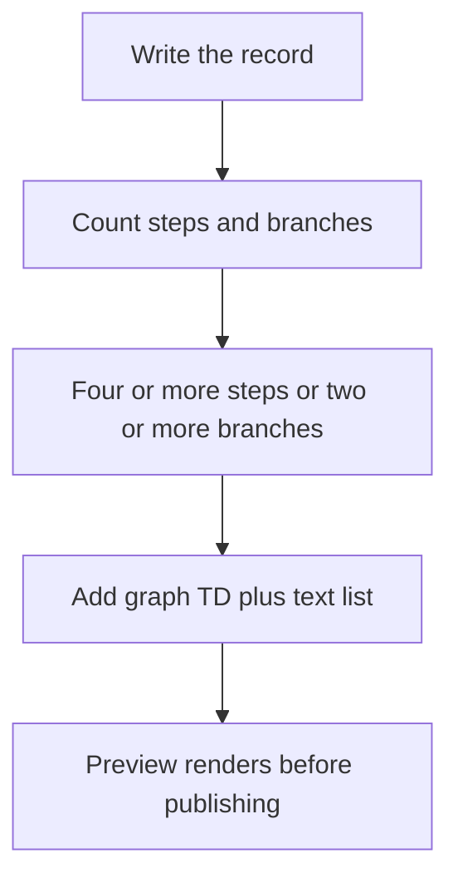

# Issue log format

One plain-language writing standard for issue logs, progress updates and pull requests that any PCM adopter can apply mechanically. The canonical issue-log *shape* belongs to OIO; this module states the prose rules PCM owns and how a writer applies them inside that shape. Apply the core guidance to every issue log, and the investigation guidance when the cause is not yet proven.

This module governs how PCM records are written. It does not define issue forms, their shape, or triage: the 3-plane human observational-issue protocol, its GitHub Issue Form, and its triage automation belong to the canonical upstream [`Pukujan/observational-issue-ops`](https://github.com/Pukujan/observational-issue-ops). See [`OBSERVATIONAL_ISSUE_DELEGATION.md`](OBSERVATIONAL_ISSUE_DELEGATION.md) for the boundary.

<!-- pcm:policy {"id":"issue-log-format","policy_version":"1.3.0","protocol_version":"0.1.0-draft"} -->

<!-- pcm:issue-log-format:start -->
## Issue log format (issue-log-format 1.3.0)

<!-- pcm:policy {"id":"issue-log-format","policy_version":"1.3.0","protocol_version":"0.1.0-draft"} -->

**The issue-log shape is OIO's.** The canonical shape — required fields, lifecycle status, typed relations, and filer provenance — is defined by [`Pukujan/observational-issue-ops`](https://github.com/Pukujan/observational-issue-ops): [`ontology/ISSUE_LOG_ONTOLOGY.md`](https://github.com/Pukujan/observational-issue-ops/blob/main/ontology/ISSUE_LOG_ONTOLOGY.md) is the semantic definition and [`.github/ISSUE_TEMPLATE/observational-issue.yml`](https://github.com/Pukujan/observational-issue-ops/blob/main/.github/ISSUE_TEMPLATE/observational-issue.yml) is the intake form. PCM does not define a competing form; fill OIO's shape and apply the writing rules below. **PCM owns the writing:** plain language, claim-first evidence, no unexplained acronym or bare identifier on first use, diagrams (mermaid), the reader-first pull-request shape, checkpoint and CURRENT projections, and the closing-keyword rule. **What an investigation record must say** (incidents, failures, research, design issues whose cause is not yet proven): numbered symptoms, each with a bold short name and one observable sentence; hypotheses with **Status** (unverified / confirmed / refuted / inconclusive), **Would confirm**, **Would refute**, and **Experiment**; evidence with provenance that names the hypothesis it supports or undercuts, plus a **Counter-signal** when one exists; an honest caveat; problems kept separate from gaps; and a **Proposal** labelled *(proposal)* that says none of it exists unless named as existing. That is guidance on what the record must say, not a second form schema. **Pull requests open reader-first:** problem and consequence, what changes, how to verify, and what stays unchanged; lineage links; evidence and one next action; long logs collapsed or linked; progress-only references use `Refs #<number>`, and a native closing keyword (`Closes`/`Fixes`/`Resolves #<number>`) only when the merge should resolve the issue. **Diagrams (mermaid):** when a record describes a flow with 4+ ordered steps or 2+ branches, add a fenced mermaid diagram *and* keep an adjacent text list or table so the record survives render failure; default to `graph TD` (vertical) because wide `LR` flows shrink to illegible strips on phones — reserve `LR` for 4 or fewer short nodes; cap 8 nodes and 6-word labels; wrap diagrams that may exceed the container width inside `<details>` (GitHub mounts the renderer lazily on expand); preview the rendered diagram before publishing (broken syntax shows a visible parse error) and never cite renderer URLs as standalone sources. **Readability rules:** the explain-the-reference rule is owned by Content Generation Modules, the single source for issue-log prose voice; read [CGM `docs/NARRATIVE_AUTHORITY.md` Rule 2](https://github.com/Pukujan/content-generation-modules/blob/main/docs/NARRATIVE_AUTHORITY.md#rule-2-explain-the-reference-before-it-carries-weight) rather than a copy here. Write evidence as the claim first, numbers as support (“nothing this change could break failed (263 tests, same six machine-environment failures as before)”), never bare counts; no unexplained acronym or bare identifier on first use in any tier; PR openings and checkpoint Completed/Next lines start with one problem sentence a newcomer can follow; the rule set applies to CURRENT projections and checkpoint entries exactly as to issue logs. No private absolute paths or secrets; link rather than paste long logs. See `docs/ISSUE_LOG_FORMAT.md` for the full format, exemplar, and examples.
<!-- pcm:issue-log-format:end -->

## The issue-log shape belongs to OIO

The canonical shape of an issue log — its required fields, lifecycle status, typed relations, filer provenance, and assessment dimensions — is defined by [`Pukujan/observational-issue-ops`](https://github.com/Pukujan/observational-issue-ops). Read [`ontology/ISSUE_LOG_ONTOLOGY.md`](https://github.com/Pukujan/observational-issue-ops/blob/main/ontology/ISSUE_LOG_ONTOLOGY.md) for the semantics and [`.github/ISSUE_TEMPLATE/observational-issue.yml`](https://github.com/Pukujan/observational-issue-ops/blob/main/.github/ISSUE_TEMPLATE/observational-issue.yml) for the intake form. PCM does not define a competing form and does not vendor a copy; a project that needs a different shape files a change against OIO. The sections below are writing guidance for filling OIO's shape, not a second schema.

## What every issue record must say (core tier)

Apply these writing requirements inside OIO's shape; they do not add or rename OIO fields.

1. **Title:** the problem and the intended direction, in plain words.
2. **Summary:** one to three short paragraphs a newcomer can follow. Cover what is affected and the consequence, where the problem does and does not happen when that contrast is known, and what the issue proposes. Define acronyms on first use. When an explanation is unproven, include one bolded sentence saying so.
3. **Identity and lineage:** leaf owning issue, parent ancestry (or explicitly none), dependencies (or none), task ID, branch, and primary writer. This is PCM's continuity requirement layered on OIO's provenance fields; it does not replace them.
4. **Observed facts vs interpretation:** label observed results, agent reports, and inferences separately. Mark a causal link that was inferred as *inferred*.
5. **Acceptance / success criteria:** observable checks. Use numeric thresholds where a measurement is involved, and mark untested thresholds *(proposed)*.
6. **Boundaries / non-goals** and **one next action**.

## What an investigation record must say (investigation tier)

When the issue concerns an incident, failure, research question, or design whose cause is not yet proven, the record must also say:

1. **Symptoms:** a numbered list with a bold short name and one observable sentence per item.
2. **Hypotheses (unverified):** each hypothesis carries an ID, a **Status** (unverified / confirmed / refuted / inconclusive), **Would confirm**, **Would refute**, and **Experiment**. A shared experiment matrix is optional. OIO's form has no hypothesis field today; record this in the issue body, not in a second form.
3. **Evidence with provenance:** source type, time with a timezone label, and redacted identifiers. Each item says which hypothesis it supports or undercuts. Include a **Counter-signal** entry when one exists. Failures unrelated to the issue are named and routed elsewhere.
4. **Honest caveat:** legitimate outcomes that must not count as failures, and what the issue is **not** trying to do.
5. **Problems vs gaps:** problems as reported (and by whom), kept separate from gaps (capabilities we lack).
6. **Proposal (marked "proposal"):** every component is labelled *(proposal)*, and the section says: "None of it exists unless named as existing." Anything named as existing gives its repository path or link.
7. **Plan:** verification before build, and small separately verified increments.

## Writing rules (every record)

Plain language first, technical names after. Use bold only for the key uncertainty or decision, not for decoration. Give exact numbers, times with a zone, and no private absolute paths or secrets. Use `Refs #<number>` for progress-only references; reserve a native closing keyword (`Closes`/`Fixes`/`Resolves #<number>`) for work the merge resolves. Link rather than paste long logs.

## Readability rules

Records the tools compose — pull-request bodies, checkpoint entries, `CURRENT.md` projections — follow the same newcomer standard as issue logs:

- **Explain the reference before it carries load.** This rule is owned by Content Generation Modules, the single source for issue-log prose voice; PCM restated it here until 1.2.0 and the second copy could drift from the first. Do not restate it: read [CGM `docs/NARRATIVE_AUTHORITY.md` Rule 2 ("explain the reference before it carries weight")](https://github.com/Pukujan/content-generation-modules/blob/main/docs/NARRATIVE_AUTHORITY.md#rule-2-explain-the-reference-before-it-carries-weight), which gives every SHA, comment id, flag name, file path, or tool name a plain-word meaning in the same sentence before it carries load.
- Write evidence as **claim first, numbers as support**: "nothing this change could break failed (263 tests, same six machine-environment failures as before)", never bare "259 = six known, 3F+1E".
- No unexplained acronym or bare identifier on first use, in any tier. Explain once, then use freely.
- PR openings and checkpoint `Completed:`/`Next:` lines start with one problem sentence a newcomer can follow; details follow below it.
- The rule set applies to CURRENT projections and checkpoint entries exactly as to issue logs — cold-start sessions read those first.

## Diagrams (mermaid)

Fenced `mermaid` blocks render natively on GitHub in issue bodies, issue comments, PR bodies, PR comments, and repository file views. These rules keep a rendered diagram readable on desktop and on a phone. Verified 2026-09-25 against GitHub's renderer (a viewscreen iframe; a ` ```mermaid info ``` ` probe reports `v11.17.2`) in the disposable matrix [`Pukujan/pcm-mermaid-matrix`](https://github.com/Pukujan/pcm-mermaid-matrix): [issue #1 probes](https://github.com/Pukujan/pcm-mermaid-matrix/issues/1), [PR #2 surfaces](https://github.com/Pukujan/pcm-mermaid-matrix/pull/2), [file view](https://github.com/Pukujan/pcm-mermaid-matrix/blob/main/MERMAID_MATRIX.md).

1. **Draw when multi-step.** A flow, state machine, decision tree, or pipeline with 4 or more ordered steps or 2 or more branches gets a diagram *in addition to* the text. Reason: prose is weakest exactly where a picture carries the shape.
2. **Text alternative mandatory.** The adjacent step list or table stays in the record beside the diagram. Reason: the record must survive render failure, API-only readers, and search.
3. **Vertical by default.** `graph TD` is the required direction. Reason: a 7-node `flowchart LR` measured 2120px wide inside an 878px container; GitHub scales it to fit, so on a 390px phone it becomes an illegible strip, while the same content as `graph TD` renders 441px wide and stays readable at both widths.
4. **`LR` only for tiny graphs.** Reserve `LR` for at most 4 short-label nodes. Reason: a horizontal flow only stays legible while the whole graph fits near the container width.
5. **Size caps.** At most 8 nodes and labels of at most 6 words (at most 2 lines per label). Reason: oversized nodes and labels are what push a diagram past the readable width.
6. **Wide diagrams collapsed.** Anything that might exceed the container width goes inside `<details>` with a summary that names the diagram. Reason: mobile readers keep the text and desktop readers expand to inspect; GitHub mounts the renderer lazily, only after the reader expands, so the cost is paid on use.
7. **Verify before publishing; never link the renderer.** The author must see the diagram render — preview it before publishing; broken syntax shows a visible "Syntax error in text" panel and the reader silently loses the information. Note the renderer version an info probe reports when you verify. Cite the markdown source location instead of renderer (viewscreen) URLs. Reason: a standalone viewscreen URL is an empty shell without the parent page's posted data, so a diagram cannot be deep-linked.

Good — small vertical graph, readable at desktop and phone width (this document renders it), with the mandatory text list beside it:



Text alternative: 1) write the record; 2) count steps and branches; 3) with 4+ steps or 2+ branches, add a `graph TD` diagram beside the text list; 4) preview the render before publishing.

Bad — a 7-node horizontal flow, described here rather than rendered so this document does not ship a bad diagram:

    flowchart LR
        A[Observed matrix] --> B[Open issue] --> C[Implement] --> D[Holdout] --> E[Open PR] --> F[CI + auto-merge] --> G[Close]

Why it fails: it measures 2120px wide in an 878px container, GitHub scales it to fit, and on a 390px phone the labels become an unreadable strip. Draw the same content as `graph TD`, or collapse it inside `<details>`.

## Pull requests and updates

Pull requests open reader-first: open with the problem and consequence, then what changes, how to verify, and what stays unchanged, so a reviewer sees the blast radius before reading the diff. Link lineage (leaf issue, parent ancestry, task ID). Close with the evidence and one next action. Collapse or link long logs; never paste them.

Reference issues with `Refs #<number>` for progress-only work. Use a native closing keyword — `Closes #<number>`, `Fixes #<number>`, or `Resolves #<number>` — only when the merge resolves the issue; GitHub recognizes closing keywords even inside a negated sentence, so never mention one in a sentence that says the work does not close it. OIO's reusable close workflow owns the transition on merge: it closes the referenced log and marks its Lifecycle Status `resolved`. Checkpoint commit messages are sanitized — `continuity checkpoint` rewrites closing directives to `Refs` unless `--allow-closing-keywords` is passed — so a checkpoint commit cannot close an issue. After every merge, verify the live issue status before reconciling task lifecycle.

## Exemplar

The reference exemplar for this format is [inference-recommendation-engine issue 40 ("IRE-40")](https://github.com/Pukujan/inference-recommendation-engine/issues/40): it explains the problem in plain language first, lists what was actually seen, labels each explanation as unverified with what would confirm or refute it, ties evidence to its source including evidence that points the other way, and marks the proposal as a proposal.

## Short-form example

A compact core-tier issue body for a routine change:

```markdown
Title: Continuity: checkpoint push fails when the task branch was rebased

Summary: Agents running `continuity checkpoint` on a rebased task branch get a
non-retryable push error and must re-run by hand. The push path assumes the
local branch tip descends from the remote tip. This proposes detecting the
divergence and reporting the exact recovery command.

Identity and lineage: Leaf: #1234. Parent: none. Dependencies: none.
Task ID: ABC-0001 (fictional). Branch: task/ABC-0001-example. Writer: <primary writer>.

Observation: repro on the current revision (fact); the branch was rebased
earlier in the session (inferred from reflog).

Acceptance: the command exits non-zero with a recovery hint, and a rerun after
following the hint succeeds. Threshold for retry wait: 30 s *(proposed)*.

Boundaries: no change to worktree removal. Next action: reproduce in tests.
```

## Updating an adopted copy

The guidance block above is delimited by `<!-- pcm:issue-log-format:start -->` and `<!-- pcm:issue-log-format:end -->` in every file that carries it. To update after a PCM upgrade: replace the text between those two markers with the current block (copied from this document or printed by the installed CLI), add the block where it is missing (e.g. a newly installed issue template), then run `continuity validate` to confirm. A stale-marker warning means the step is still needed; `continuity validate` prints the same instruction.

## Changelog

- **1.3.0 (2026-10-14):** makes two ownership changes under the OIO #52 consolidation ruling. First, deduplicates the explain-the-reference rule: the "Readability rules" section and the pinned guidance block no longer restate it in PCM's own words; both point at [CGM `docs/NARRATIVE_AUTHORITY.md` Rule 2](https://github.com/Pukujan/content-generation-modules/blob/main/docs/NARRATIVE_AUTHORITY.md#rule-2-explain-the-reference-before-it-carries-weight), the single source for issue-log prose voice. Second, defers the issue-log *shape* to OIO: the canonical form is [`Pukujan/observational-issue-ops`](https://github.com/Pukujan/observational-issue-ops) [`ontology/ISSUE_LOG_ONTOLOGY.md`](https://github.com/Pukujan/observational-issue-ops/blob/main/ontology/ISSUE_LOG_ONTOLOGY.md) and [`.github/ISSUE_TEMPLATE/observational-issue.yml`](https://github.com/Pukujan/observational-issue-ops/blob/main/.github/ISSUE_TEMPLATE/observational-issue.yml); PCM no longer defines a competing Core/Investigation form schema and keeps only the writing guidance it owns, including "what an investigation record must say" (the hypothesis block OIO's form lacks today). The closing-keyword rule now separates progress-only `Refs #<number>` from a native closing keyword when the merge resolves the issue and notes OIO's close workflow. Provenance: issue [#252](https://github.com/Pukujan/project-continuity-modules/issues/252). Pointer targets exist on CGM and OIO `main` today, so the change does not wait on any other repository's pending work.
- **1.2.0 (2026-09-26):** adds the readability rules (plain-word meaning before identifiers carry load; claim-first evidence with numbers as support; no bare acronyms/ids on first use; PR openings and checkpoint/CURRENT lines lead with one problem sentence). Provenance: issue [#180](https://github.com/Pukujan/project-continuity-modules/issues/180), motivated by this session's own PR bodies (before/after exemplar: [PR #178 comment 5842450065](https://github.com/Pukujan/project-continuity-modules/pull/178#issuecomment-5842450065)).
- **1.1.0 (2026-09-25):** adds the diagram rules (when to draw, `graph TD` default, size caps, mandatory text alternative, collapsed wide diagrams, verify-before-publish, no standalone renderer links). Provenance: issue [#126](https://github.com/Pukujan/project-continuity-modules/issues/126), from browser-verified rendering evidence in the disposable matrix [`Pukujan/pcm-mermaid-matrix`](https://github.com/Pukujan/pcm-mermaid-matrix) ([issue #1](https://github.com/Pukujan/pcm-mermaid-matrix/issues/1), [PR #2](https://github.com/Pukujan/pcm-mermaid-matrix/pull/2), [blob view](https://github.com/Pukujan/pcm-mermaid-matrix/blob/main/MERMAID_MATRIX.md)).
- **1.0.0 (2026-09-25):** initial release. Provenance: issue [#99](https://github.com/Pukujan/project-continuity-modules/issues/99) format spec, under the owner direction recorded in [comment 5828143593](https://github.com/Pukujan/project-continuity-modules/issues/99#issuecomment-5828143593) (severity contract: missing marker warns, contradictory versions error, stale markers warn with the update step).
